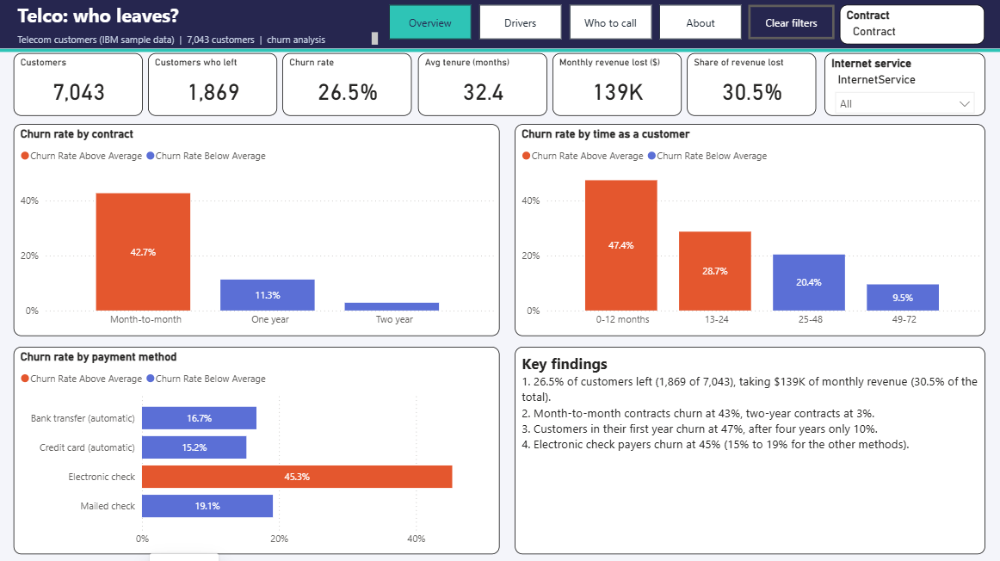
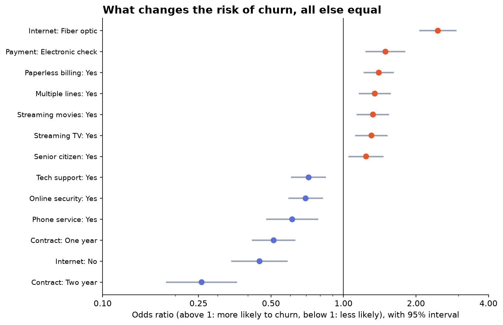
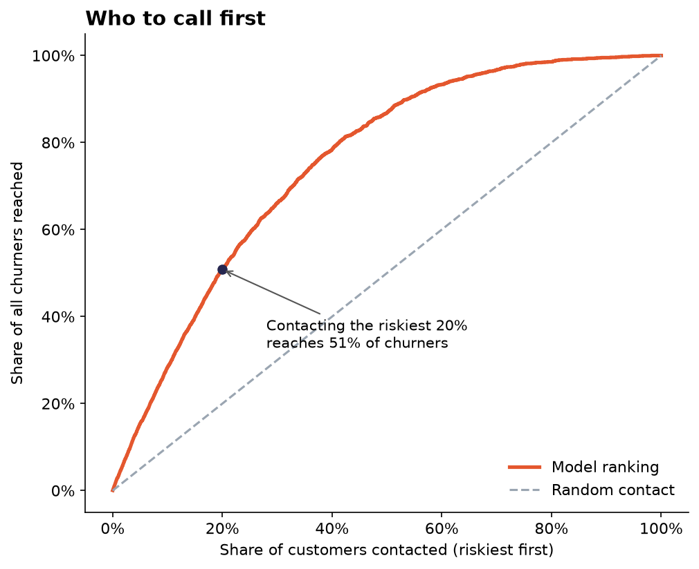
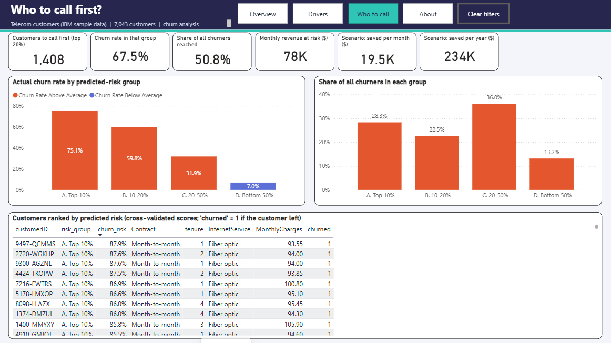

# Telco Customer Churn: Who Leaves, Why, and Who to Call First

**A telecom operator loses 26.5% of its customers. Which ones, why, and which should it contact first?**
An analysis of 7,043 customers with Python (logistic regression, prediction) and a four-page Power BI dashboard. The main finding: **month-to-month contracts, a first year as a customer and fiber optic drive churn, and calling the riskiest 20% of customers reaches half of all churners**.



## Key findings

| # | Finding | Evidence |
|---|---|---|
| 1 | **Churn is a big revenue problem.** | 1,869 of 7,043 customers left (**26.5%**). They paid **$139K a month, 30.5% of all revenue**. |
| 2 | **Contract type is the strongest signal.** | Churn is **43%** on month-to-month contracts, 11% on one-year and **3%** on two-year contracts. |
| 3 | **The first year is the danger zone.** | Churn is **47%** in the first 12 months and 10% after four years. Churners leave after 18 months on average, others stay 38. |
| 4 | **Fiber optic and electronic check customers churn more.** | Fiber: **42%** vs 19% for DSL. Electronic check: **45%** vs 15% to 19% for other payment methods. |
| 5 | **Support services protect.** | Among internet customers, churn is **15%** with tech support and **42%** without. |
| 6 | **Churn can be predicted.** | AUC **0.845** on customers the model had not seen. |
| 7 | **Calling the riskiest 20% pays off.** | Those 1,408 customers contain **51% of all churners** (a 67.5% churn rate, 2.5 times the average). |

## What drives churn, all else equal

A logistic regression holds the other factors constant. A factor with an odds ratio above 1 raises the odds of churn, below 1 lowers them.

| Factor | Odds ratio (95% interval) | Reading |
|---|---|---|
| Two-year contract (vs month-to-month) | **0.26** (0.18 to 0.36) | odds four times lower |
| One-year contract | 0.51 (0.42 to 0.63) | odds about halved |
| Fiber optic (vs DSL) | **2.47** (2.06 to 2.95) | odds 2.5 times higher |
| Electronic check (vs credit card) | 1.49 (1.23 to 1.81) | +49% |
| Paperless billing | 1.40 (1.21 to 1.62) | +40% |
| Tech support | 0.72 (0.61 to 0.85) | -28% |
| Online security | 0.70 (0.59 to 0.82) | -30% |
| Each extra 12 months of tenure | 0.66 | -34% |
| Gender | 0.98 (0.86 to 1.11) | **no effect** |



### A statistical trap caught on the way
The first model gave fiber optic an odds ratio of **5.6 with an interval from 1.2 to 27**, far too wide to trust. The cause was **collinearity**: the monthly bill is almost entirely determined by the services a customer has chosen (variance inflation factor of **863**, where above 10 is a problem). Removing it from the driver model brought the largest VIF down to **2.8** and fiber optic to a stable **2.5 (2.1 to 2.9)**. The bill stays in the prediction models, where collinearity does no harm.

## Who to call first

Customers were ranked by predicted risk (5-fold cross-validated scores, so each customer is scored by a model that never saw them).

| Risk group | Customers | Actual churn rate | Share of all churners |
|---|---|---|---|
| A. Top 10% | 704 | 75.1% | 28.3% |
| B. 10-20% | 704 | 59.8% | 22.5% |
| C. 20-50% | 2,113 | 31.9% | 36.0% |
| D. Bottom 50% | 3,522 | 7.0% | 13.2% |



**Scenario (an assumption, not a prediction):** the churners among the top 20% pay $78K a month. If a retention offer saved **25%** of them, the company would keep **about $19.5K a month, or $234K a year**. The 25% is a figure to test with an A/B experiment.

## Recommendations

1. **Move month-to-month customers, especially in their first year, to one- or two-year contracts** with an incentive. This is the biggest and clearest lever.
2. **Offer tech support and online security to fiber customers who lack them**: both are linked to lower churn, and fiber customers churn the most.
3. **Encourage automatic payment** for customers paying by electronic check.
4. **Use the model's ranking** to contact the riskiest 20% first, and measure the offer with an A/B test before scaling.

## Limitations (what this analysis cannot say)

- **Association is not causation.** The regression holds the other factors constant, but customers who take a two-year contract may differ in ways the data does not show.
- **The 25% save rate is an assumption**, and the dollar figures are a scenario, not a forecast.
- The data is a **one-month snapshot** of a fictional operator (IBM sample data), so the results illustrate a method.
- The model uses the services and billing at the time of the snapshot, not the full customer history.

## How the analysis was done

| Stage | What was done | Where |
|---|---|---|
| Business understanding | Five questions: who churns, why, can it be predicted, who to call, how much money | this README |
| Data audit and cleaning | 7,043 rows, 21 columns, no duplicates. Two traps: `TotalCharges` is text because 11 new customers (tenure 0) have a blank value, and "No internet service" repeats what the internet column already says | [`src/churn_analysis.py`](src/churn_analysis.py) |
| Drivers | Logistic regression, odds ratios with 95% intervals, collinearity check (VIF) | `src/churn_analysis.py` |
| Prediction | Logistic regression vs gradient boosting: both reach AUC 0.845, so the explainable model was kept | `src/churn_analysis.py` |
| Targeting | Cross-validated risk scores, gains curve, risk groups, revenue scenario | `src/churn_analysis.py` |
| Dashboard | Power BI: 2 tables, 22 DAX measures, 4 pages (Overview, Drivers, Who to call, About) | [`powerbi/`](powerbi/) |
| Insights | Findings, recommendations, limitations | this README, [`reports/executive_summary.md`](reports/executive_summary.md) |



## Reproduce it

1. Download the data from [Kaggle: Telco Customer Churn](https://www.kaggle.com/datasets/blastchar/telco-customer-churn) and put `WA_Fn-UseC_-Telco-Customer-Churn.csv` in `data/`.
2. Install the libraries: `pip install -r requirements.txt`
3. Run:

```bash
python src/churn_analysis.py     # cleaning, regression, prediction, charts, tables
python powerbi/build_pbip.py     # generates the Power BI project (optional)
```

To open the Power BI dashboard, open `powerbi/telco_dashboard.pbip` in Power BI Desktop, then click **Refresh now** (wait for each load to finish before clicking again). The parameters `DataFolder` and `TablesFolder` point to `data/processed/` and `reports/tables/`; change them under Transform data > Edit parameters if you move the project.

## Project structure

```
03-telco-churn-analysis/
├── src/churn_analysis.py   cleaning, regression, prediction, targeting
├── powerbi/                build script that generates the Power BI project
├── reports/                executive summary, charts, result tables, results JSON
└── requirements.txt
```

**Tools:** Python (pandas, statsmodels, scikit-learn, matplotlib), Power BI (Power Query, DAX).

**Author:** Hadil Ziane, MSc Statistics & Economic Foresight (ENSSEA).
